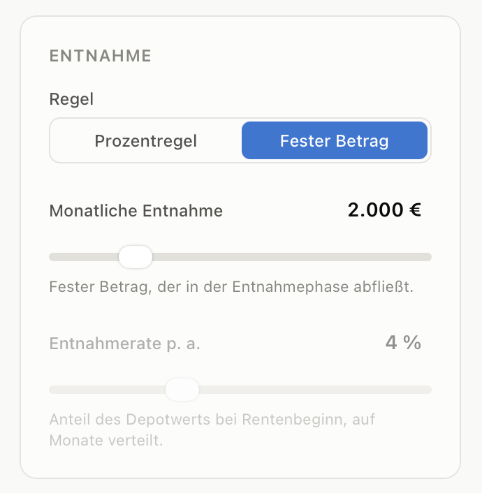
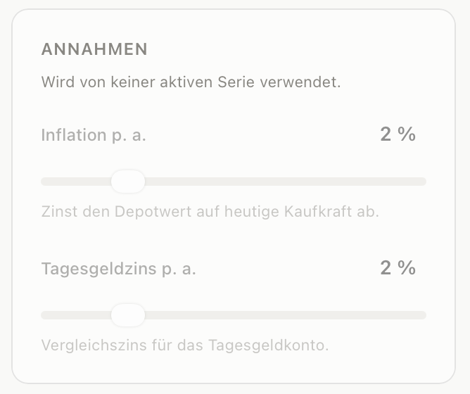

## 1

warum wird das andere ausgegraut?? nur das aktuelle anzeigen

## 2

ausgegraute sachen nicht anzeigen

## 3

die website soll als höhe die fenster größe haben sodass das nicht gescrollt wird

## 4

die website ist nicht responsive. mach es mobile first design.
